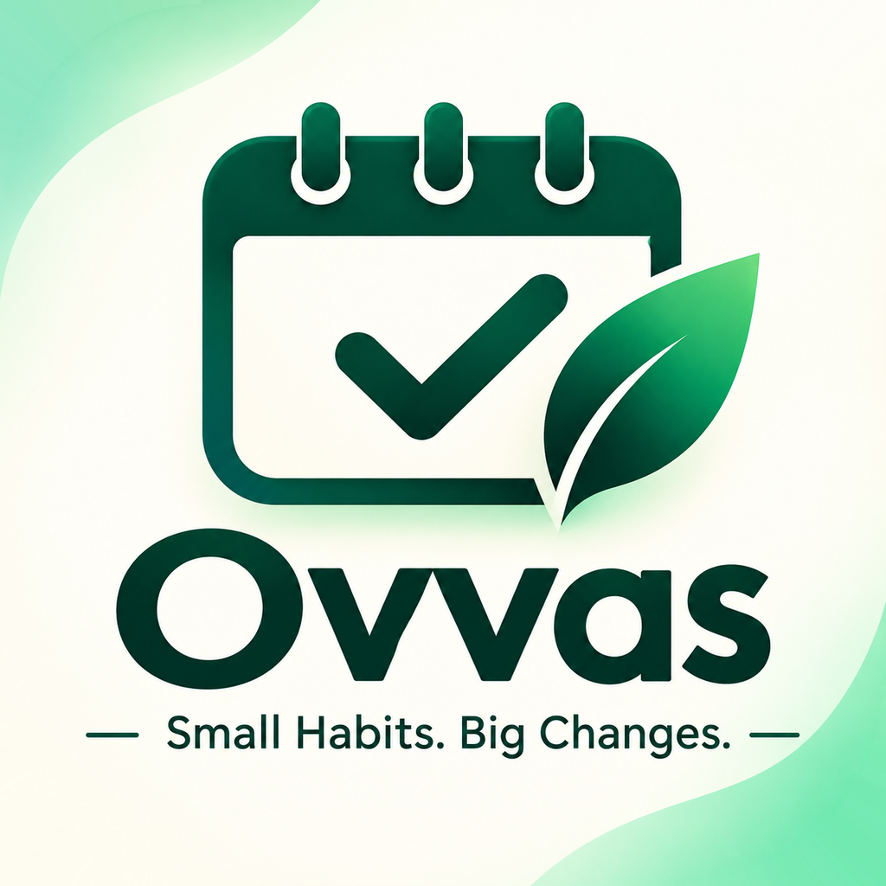
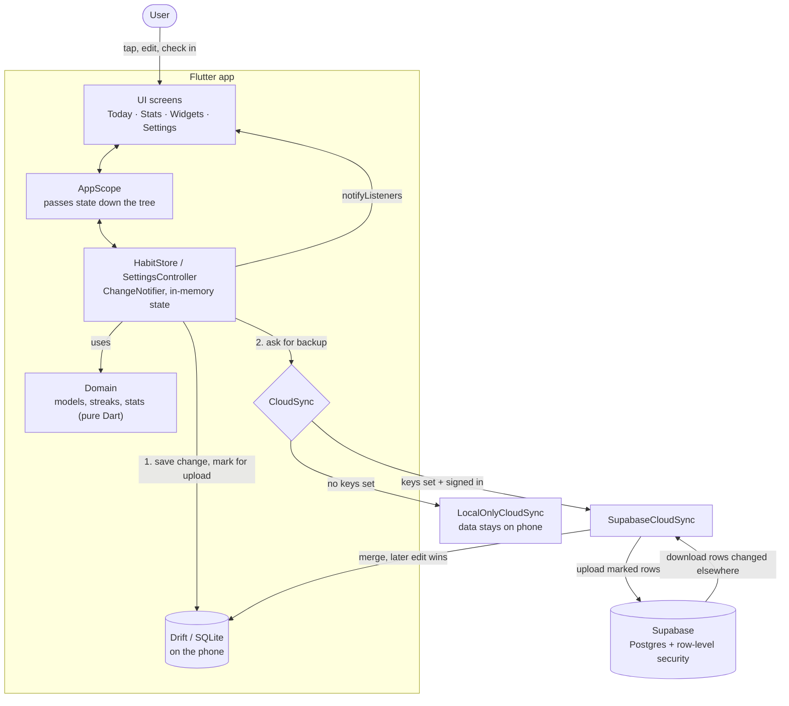
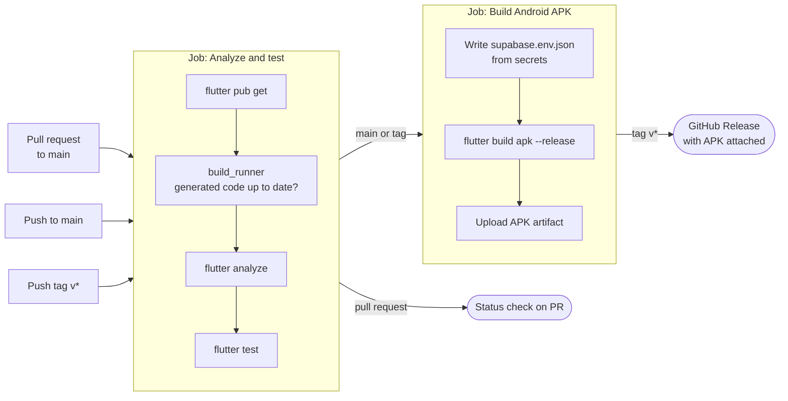

<p align="center">
  
</p>

<h1 align="center">Ovvas</h1>

<p align="center">Small habits. Big changes.<br>A calm, ad-free habit tracker built with Flutter.</p>

> **Status:** all screens are built. Data is saved on the phone (SQLite via Drift). Google sign-in and cloud sync use Supabase when it is configured; without it, the app keeps data on the phone only. Debug builds start with sample habits on a fresh install.

## Features

- **Today** — check in with one tap. See a progress ring for the day, and go back to edit past days.
- **Three goal types** — Yes/No, Count (e.g. 8 glasses), and Time (in minutes).
- **Flexible schedules** — every day, chosen weekdays, or a number of times per week, with optional start and end dates.
- **Skip days** — skipping a day doesn't break your streak or lower your completion rate.
- **Notes** — add a note to any day's check-in.
- **Reminders** — one or more per habit, plus a default reminder time and quiet hours.
- **Stats** — weekly and monthly views, current and longest streaks, completion rates, and simple insights (for example, "Mondays are your hardest day").
- **Home screen widgets** — design and preview six widget types: single habit, today list, progress ring, week strip, month heatmap, and streak counter. Each has its own sizes, themes, backgrounds, and corner styles. The free version allows 3 widgets.
- **Archive or delete** — archive a habit to keep its history, or delete it completely.
- **Personalisation** — light, dark, or system theme; in-app text size; first day of the week; haptics, animations, and celebrations on or off.
- **Languages** — English and Bangla (বাংলা).

## Getting started

### Requirements

- Flutter with Dart SDK `^3.13.7`

### Run

```bash
flutter pub get
flutter run
```

Localization files are generated automatically from the `.arb` files when you build (`generate: true` in `pubspec.yaml`). To regenerate them by hand:

```bash
flutter gen-l10n
```

After changing the tables in [database.dart](lib/data/local/database.dart), regenerate the database code:

```bash
dart run build_runner build
```

### Cloud backup (Supabase)

Optional. Without it, everything works and stays on the phone.

1. Create a project at [supabase.com](https://supabase.com).
2. Run [supabase/migrations/20261108000000_ovvas_sync.sql](supabase/migrations/20261108000000_ovvas_sync.sql) in the SQL editor (or `supabase db push` with the Supabase CLI). It creates the tables and the rules that keep each user's data private.
3. Turn on Google sign-in: **Authentication → Sign In / Providers → Google**, using a Google Cloud OAuth client ID and secret.
4. Under **Authentication → URL Configuration → Redirect URLs**, add both:
   - `ovvas://login-callback` (Android and iOS)
   - `http://127.0.0.1:43823/login-callback` (Linux, Windows and macOS, where the browser returns to the app through a short-lived local address)
5. Copy `supabase.env.example.json` to `supabase.env.json` (ignored by git) and fill in your project URL and publishable key (**Project Settings → API Keys**). Then run:

```bash
flutter run --dart-define-from-file=supabase.env.json
```

In VS Code, pick the **Ovvas (cloud backup)** launch configuration.

How sync works: every change is saved on the phone first and marked for upload. About two seconds after a change, when the app returns to the foreground, and on **Back up now**, the app uploads marked rows and downloads rows changed elsewhere. If two phones edit the same thing, the later edit wins. Deleted items are kept as "deleted" markers so the deletion reaches every phone.

### App icon

The app icon source lives in [assets/icon/](assets/icon/) (calendar-and-leaf mark). The full logo with the name is [assets/brand/logo_full.png](assets/brand/logo_full.png). After replacing the icon, regenerate the icons for every platform:

```bash
dart run flutter_launcher_icons
```

Settings are under `flutter_launcher_icons:` in [pubspec.yaml](pubspec.yaml). After running it, undo the change it makes to `ios/Runner.xcodeproj/project.pbxproj` (`git checkout` that file); the tool writes an invalid build setting there.

### Test

```bash
flutter test
```

The widget tests in [test/widget_test.dart](test/widget_test.dart) run the app with a fixed clock and sample data, in both themes and languages, at different screen widths and text sizes. They use an in-memory store and a fake cloud. [test/database_test.dart](test/database_test.dart) checks that data and settings survive a restart, using an in-memory SQLite database.

## How it works



1. A screen calls a method on `HabitStore` (for example, a check-in).
2. The store updates its in-memory state, so the screen redraws at once.
3. The change is written to the local Drift database and marked for upload.
4. `CloudSync` uploads marked rows about two seconds later, when the app returns to the foreground, or on **Back up now**. It also downloads rows changed on other phones.
5. Without Supabase keys, `LocalOnlyCloudSync` is used and nothing leaves the phone.

### Layers

- **Domain** holds plain models and pure functions with no Flutter UI code, so the streak and stats logic is easy to test.
- **Data** exposes `HabitStore` and `SettingsController`, both `ChangeNotifier`s. Screens only talk to these classes.
- **AppScope** passes the store and settings down the widget tree.
- No third-party state management or chart packages are used; charts are drawn with Flutter's own widgets.

## Project structure

```
ovvas/
├── lib/
│   ├── main.dart                     # Entry point: opens the database and cloud sync
│   ├── app/
│   │   ├── app.dart                  # MaterialApp, theme, locale
│   │   └── app_scope.dart            # Passes store and settings down the tree
│   ├── core/theme/
│   │   ├── app_colors.dart           # Color tokens
│   │   ├── app_theme.dart            # Light and dark ThemeData
│   │   └── habit_palette.dart        # Habit colors
│   ├── domain/                       # Pure Dart models and logic
│   │   ├── habit.dart                # Habit, DayEntry, goal and repeat types
│   │   ├── stats.dart                # Streaks, completion rates, summaries
│   │   ├── widget_config.dart        # Home screen widget options
│   │   └── dates.dart                # Date helpers
│   ├── data/                         # State and storage
│   │   ├── habit_store.dart          # Habits, check-ins, widgets
│   │   ├── settings_controller.dart  # User settings
│   │   ├── sample_data.dart          # Demo habits for debug builds
│   │   ├── local/
│   │   │   ├── database.dart         # Drift tables
│   │   │   ├── database.g.dart       # Generated by build_runner
│   │   │   └── records.dart          # Model <-> row converters
│   │   └── sync/
│   │       ├── cloud_sync.dart       # CloudSync interface, local-only and fake versions
│   │       ├── cloud_setup.dart      # Picks Supabase or local-only from dart-defines
│   │       └── supabase_sync.dart    # Upload/download with Supabase
│   ├── l10n/
│   │   ├── app_en.arb, app_bn.arb    # English and Bangla strings
│   │   └── app_localizations*.dart   # Generated by flutter gen-l10n
│   └── ui/
│       ├── home_shell.dart           # Bottom navigation
│       ├── routes.dart               # Navigation helpers
│       ├── today/                    # Today screen and habit cards
│       ├── habit/                    # Habit details and add/edit form
│       ├── stats/                    # Stats screen
│       ├── widgets/                  # Widget gallery, builder, previews
│       ├── settings/                 # Settings screen
│       └── common/                   # Shared components, charts, dialogs, formatting
├── test/
│   ├── widget_test.dart              # Every screen, both themes and languages
│   └── database_test.dart            # Data survives a restart
├── assets/
│   ├── icon/                         # Logo mark; source for launcher icons
│   └── brand/                        # Full logo (README) and in-app logo mark
├── supabase/migrations/              # Server tables and security rules
├── .github/workflows/ci.yml          # CI/CD pipeline
├── android/ ios/ web/ linux/ macos/ windows/   # Platform projects
├── supabase.env.example.json         # Template for Supabase keys
├── l10n.yaml                         # Localization settings
└── pubspec.yaml                      # Packages and app version
```

## CI/CD

GitHub Actions runs [.github/workflows/ci.yml](.github/workflows/ci.yml).



| Trigger | What runs |
| --- | --- |
| Pull request to `main` | Analyze and test |
| Push to `main` | Analyze and test, then build the APK and upload it as a workflow artifact |
| Push a tag like `v1.0.0` | Same as `main`, plus a GitHub Release with the APK attached |
| Manual (**Run workflow**) | Same as a push to the selected branch |

**Secrets** (optional, under **Settings → Secrets and variables → Actions**):

- `SUPABASE_URL`
- `SUPABASE_PUBLISHABLE_KEY`

Without them, the built APK keeps data on the phone only.

**Making a release:**

```bash
# bump `version:` in pubspec.yaml first
git tag v1.0.0
git push origin v1.0.0
```

The APK is signed with the debug key for now. Set up a release keystore before publishing to the Play Store.

**Run the same checks locally before pushing:**

```bash
flutter pub get
dart run build_runner build --delete-conflicting-outputs
flutter analyze
flutter test
```

## Adding a translation

1. Copy `lib/l10n/app_en.arb` to `lib/l10n/app_<code>.arb` and translate the values.
2. Run `flutter gen-l10n` (or just build the app).
3. Add the language to the language picker options in [settings_screen.dart](lib/ui/settings/settings_screen.dart).
